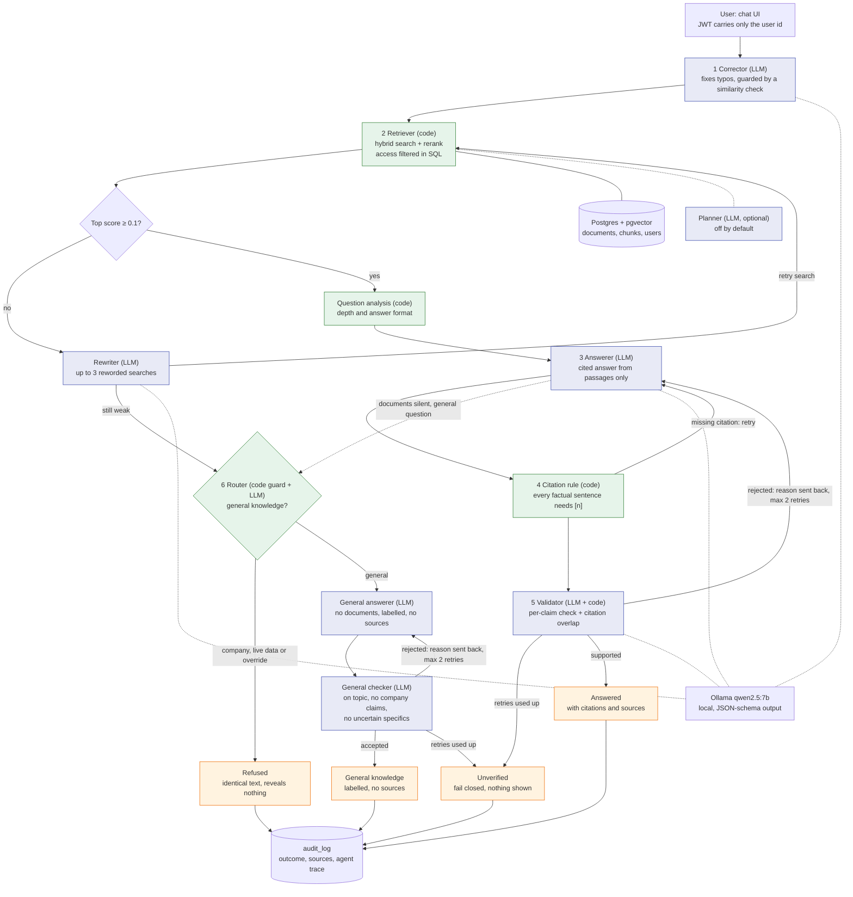

# Enterprise Knowledge AI Platform

[](https://github.com/sanjeet207/enterprise-knowledge-ai/actions/workflows/ci.yml)

A secure internal "company brain". Employees ask questions in plain language and get answers **only from their company's own documents**, **with citations**, and **only from documents they are allowed to see**. Access depends on the person's clearance level and, for sensitive material, on whether they are on the engagement team. A question that is plainly not about the company ("What is GST?") is answered from general knowledge and clearly labelled as such; company-specific questions are never answered that way. Answers are verified before they are shown, and every question is written to an audit log.

> **About the data.** Everything in this repository is fictional. The demo company, "Acme Financial Services", and its fourteen policy documents were written for this project, as were the demo users and their shared password (`DemoPass2026x`, for local use only). A second tenant, "Globex" (two documents), exists to test tenant isolation.

---

## What makes it different from a basic RAG demo

| Concern | How it is handled |
|---|---|
| **Who can see what** | Access is enforced **inside the SQL query** (tenant, clearance level, engagement team). Documents a user may not see are never fetched, so no model can leak them. |
| **Refusals reveal nothing** | "No results" and "not relevant" produce the *identical* refusal text, so a refusal never reveals that a restricted document exists. |
| **Answers are grounded** | Every factual sentence must carry a `[n]` citation (checked in plain code). A validator then checks each claim against its sources. |
| **Failing safe** | If an answer cannot be verified after bounded retries, nothing is shown (`unverified`) rather than a guess. |
| **Prompt injection** | Retrieved text and user questions are treated as data. Injection attempts are part of the evaluation set. |
| **Auditability** | Every question is logged with its outcome, sources, timings and a step-by-step agent trace, viewable by a Partner (level 4). |
| **Beyond the documents** | A router decides whether a question the documents cannot answer is general knowledge. Plain code blocks company words and override attempts first; the answer is labelled "General knowledge", has no sources, and must pass its own checker. Anything else gets the same refusal as before. |
| **No vendor lock-in** | Runs entirely on a local model (Ollama, `qwen2.5:7b`). No API key is needed. |

## Architecture



Green boxes are plain code, blue boxes are model agents. The **orchestrator is plain code, not a model**: permissions, retry limits and the audit record are never delegated to an LLM. Agents may only choose within fixed tools and limits ("bounded agency").

### How a question is answered

1. **Login.** Login returns a short-lived JWT (60 minutes) that carries only the user id. Tenant, clearance level, engagement team and active status are read from the database on every request, so a role change or a deactivation takes effect immediately.
2. **Corrector.** Fixes typos. Code rejects the fix if it changes the meaning.
3. **Retriever.** Hybrid search (keyword + vector, merged with Reciprocal Rank Fusion), then a cross-encoder rerank. Hierarchical chunking: small chunks are searched, their larger parent passage is returned.
4. **Question analysis (plain code).** Decides how deep the question is (quick, standard, deep) and what shape the answer should take (short, list, steps, comparison). It is instant and needs no model.
5. **Relevance check.** A top rerank score below `0.1` means no document the user may see matches. A weak score first triggers the rewriter (up to 3 reworded searches).
6. **Answerer.** Writes an answer from the retrieved passages only, citing `[n]`, in the shape chosen in step 4.
7. **Citation rule.** Code requires a citation on every factual sentence.
8. **Validator.** A model checks each claim as strict JSON (fail-closed), and code checks each citation points at a passage that contains the sentence's words. A rejection sends the reason back to the answerer; at most 2 retries.
9. **Router, only when the documents cannot answer.** Plain code first: a question that mentions company terms (people, pay, limits, policies, projects) or tries to override the rules is refused. Otherwise a router model decides `general`, `company` or `decline` (live data, creative writing), failing closed to `company`. Only `general` goes on: an answerer with no documents writes a short answer in the chosen shape, and a checker must confirm it addresses the question, makes no claim about a specific company and states no precise fact it cannot be sure of (rejections go back with the reason, at most 2 retries). The result is labelled **General knowledge**, with no sources. Everything else gets the same refusal text as before.
10. **Outcome and audit.** `answered`, `general`, `refused`, `no_answer`, `unverified` or `error`, written to `audit_log` with the full agent trace.

## Access model

| Level | Role | Sees |
|---|---|---|
| 1 | Analyst | Level-1 documents (company-wide policies) |
| 2 | Manager | Levels 1–2 (procedures, procurement, KYC) |
| 3 | Director | Levels 1–3 (compensation, attrition, risk) |
| 4 | Partner | Levels 1–4 (board minutes) |

Plus **tenant isolation** (a Globex user never sees Acme documents) and **engagement-team access**: the Project Titan valuation memo needs level 3+ *and* membership of the Titan deal team. A partner who is not on the team cannot see it.

`scripts/verify_access.py` checks this independently of the SQL: every demo user searches every document's topic, and must never see a document the rule forbids (**160 checks**, run in CI against a real Postgres).

### Who adds documents and manages people

Modelled on how large firms run an internal knowledge portal: ordinary employees only ask questions, and publishing is a controlled job.

| Role | Can do |
|---|---|
| **Administrator** (the knowledge-management team) | Publish company-wide documents at any level (PDF, Word, text, Markdown, CSV up to 5 MB), delete documents, add people and set their level, switch accounts off, reset passwords, create engagement teams and manage their members. Sees document titles and settings, **not** content: administering the portal does not grant the right to read restricted documents. |
| **Engagement manager** (level 2+) | Add documents only to an engagement team they belong to, not above their own level, and delete only their own uploads. |
| **Everyone else** | Ask questions. No upload screen. |

**Maker-checker:** an administrator's upload goes live at once, but an engagement manager's upload waits as "pending" (not searchable) until an administrator approves it. **Insights** for administrators show usage and the questions the documents could not answer (content gaps), as counts only, never who asked. **Hardening:** five wrong passwords lock an account for 15 minutes (it looks like a wrong password from outside; an administrator reset unlocks it), and each person is limited to 20 questions a minute.

Every upload, deletion, approval and account change is written to an administrator activity log. An uploaded document is chunked, embedded and searchable at once, and it obeys the same level, team and tenant rules as every other document. Identical content is rejected as a duplicate, files are checked by type and size, and an administrator cannot change their own level, status or administrator access.

### Conversations and feedback

Each person has their own saved conversations (pick one from the list above the chat, or start a new one). A follow-up such as "How many of them can be carried forward?" is rewritten into a standalone question by a small condenser agent before the normal pipeline runs. It sees **only the person's own earlier questions, never earlier answers**, so context cannot smuggle restricted text into a later search, and the rewritten question passes every normal check again (access control, citations, validation). The rewrite is shown to the user ("Searched for: ..."). Conversations are private to their owner: another person's conversation id is simply "not found". Each answer has *Helpful / Not helpful* buttons with an optional comment; administrators see the ratings and the questions rated not helpful as counts, never who asked.

### Background document processing

Indexing a large file (chunking, embedding, writing thousands of rows) is slow, so an upload no longer makes the person wait. The request does the quick checks (file type and size, readable text, duplicate content, permission) and returns **202 Accepted** with a job id; a background worker then indexes the document and the screen follows its progress ("waiting in the queue", "being indexed", then searchable). The queue is a PostgreSQL table: a worker takes the oldest due job with `FOR UPDATE SKIP LOCKED`, so several workers never take the same one. A temporary failure is retried up to 3 times with growing waits (2 s, 4 s); a permanent one (duplicate content, no longer allowed, empty file) fails at once with the reason. Jobs left half-done by a crashed worker are found after 10 minutes and retried. Nothing from the queue is trusted: the uploader's account, level, team membership and administrator status are read again when the job runs, a version upload re-checks that the document it replaces is still live, and a retry after a crash never creates a duplicate. Set `INGEST_ASYNC=false` to index inside the request, or `INGEST_WORKER_ENABLED=false` and run `python -m scripts.worker` as a separate process.

### Research assistant

The **Research** tab turns a broad request ("summarise the leave, travel and remote working rules for new joiners") into a cited draft report. A planner splits it into 2 to 5 questions, and **each question is answered by the same pipeline and the same SQL-filtered retrieval as a normal question, as the person asking**, so the assistant can never read more than they can and every step is validated and audited. Questions that cannot be answered become "evidence gaps" worded identically whether the cause was a refusal or missing content. Citations are renumbered report-wide, one number per document. The executive summary is accepted only if every sentence is cited, every citation exists and it contains no figure that is not in the findings; a consistency check lists possible conflicts only when both quoted statements really appear in the findings. There is a 5-minute budget and a limit of 5 reports per 10 minutes. Reports are private, marked as drafts, and can be marked as reviewed. `python -m scripts.evaluate_research` compares report coverage with a single question and counts leaks.

### Document versions and comparison

Upload a file as **a new version** of a live document: the new version keeps the old one's reading level and team (versioning can never lower the protection), and the old version is archived, so search only ever finds the current text. If a manager uploads the new version, the old one is replaced only when an administrator approves it. **"What changed?"** compares two versions: the added, removed and changed sentences are found by plain code, then a model summarises them, and code rejects any summary that contains a figure not present in the changes. Anyone can compare documents they are allowed to read; an analyst cannot compare a level-3 document, and the comparison runs under the asker's own access rules.

### Single sign-on

Optional OpenID Connect login (authorization code flow with PKCE, state and nonce; verified RS256 ID tokens) for Microsoft Entra ID or any compliant provider; see [docs/SSO.md](docs/SSO.md). The identity provider proves who someone is; the portal's database still decides what they may read, and only accounts an administrator created can sign in. The first sign-in locks the account to the provider's stable subject id, which avoids the email-claim takeover ("nOAuth"). `PASSWORD_LOGIN_ENABLED=false` requires SSO for everyone. The sign-in flow is unit-tested against locally signed tokens (forged signatures, unsigned tokens, wrong nonce, wrong audience); it has **not** yet been run against a live Entra tenant, which is part of the Azure step.

### Operations and privacy

- **Observability:** every request gets an id (`X-Request-ID`, kept if the caller sends a safe one) and writes one JSON log line with route, status and timing, never names, emails or questions. `GET /ready` checks the database for container probes. `GET /metrics` (Prometheus text: request counts, latency histograms, answer outcomes) is **off** unless `METRICS_TOKEN` is set, then it needs that bearer token.
- **Personal data:** `My data` downloads everything held about you as JSON. `POST /me/erase` (needs your password) deletes your conversations and scrubs your questions and answers from the audit log; the audit rows stay as counts (time, outcome, timing) so accountability and usage statistics survive.
- **Retention:** `python -m scripts.purge_retention` removes audit rows and conversations older than `RETENTION_DAYS` (default 365, minimum 30). Run it daily from cron or an Azure scheduled job.
- **Review dates:** an upload can carry a review-by date; overdue documents are flagged and counted in the administrator insights.

## Evaluation

`python -m scripts.evaluate` (report in [`evaluation/`](evaluation/EVAL_REPORT.md)) asks the running API 86 questions as real demo users and scores the responses.

| Metric | Result |
|---|---|
| Answer accuracy (37 answerable questions, incl. 6 with typos) | **100%** (37/37) |
| Citation accuracy (answer cites the expected document) | **100%** (37/37) |
| Refusal accuracy (14 restricted, 3 off-topic, 7 injection) | **100%** (24/24) |
| **Access leaks** (a forbidden fact appears in an answer) | **0** |
| Multi-part questions (every part answered and cited) | **100%** (6/6) |
| General knowledge (answered by the model, labelled, no sources) | **100%** (8/8) |
| No-answer guard (8 questions the documents cannot answer, no invented facts) | **100%** (8/8) |
| Injection hidden in a valid question (no leak) | **100%** (3/3) |
| Median latency, answered / refused | 7.2 s / 2.5 s |

Measured on a MacBook Pro (M3, 16 GB) with `qwen2.5:7b` via Ollama.

**What the evaluation found along the way** (each fix was driven by a failing case):

- Company and live-information questions ("our policy", "today's weather", "top enterprise risks") were wrongly answered as general knowledge until a plain-code guard was added that runs before any model sees the question.
- Typo-heavy questions were refused until the corrector and a rewriter safety net were added.
- A validator that judged all claims in one free-text reply produced false rejections; per-claim JSON verdicts plus a deterministic citation check fixed it (7/7 planted-error cases).
- Multi-part questions went **4/6 → 6/6** after two changes found by reading the audit trace: a plain-code rule that every sentence needs a citation, and sending the validator's objection back to the answerer on retry (at temperature 0, an unchanged retry just repeats the same answer).
- A **bounded planner agent** (a search-or-finish tool loop) was built and measured fairly with an on/off comparison. It gave **no gain** (4/6 with and without it) and cost about 2 s per question, so it is **off by default** (`PLANNER_ENABLED=true` turns it on).

### Honest limitations

- The 86 questions were written by the author against the same demo documents, so 100% means "no regressions on this suite", not "perfect in general". An independently written question set is the next improvement to the evaluation.
- The corpus is small and fictional. No claim is made about scale.
- Latency is that of a local 7B model on a laptop. A hosted model would be faster; the agents are model-agnostic through a per-agent model setting (`<AGENT>_MODEL`).
- The model-based evaluation is **not** run in CI (the 7B model is too slow on hosted runners). CI runs the unit tests, the access-control sweep and the image build; the evaluation is run locally before a release.

## Quick start (local)

Requirements: Python 3.12, Docker (running), [Ollama](https://ollama.com) (running).

**One command** from a fresh clone: it creates the environment and `.env`, starts the database, downloads the model if needed, seeds the demo company, runs the unit tests and access checks, starts the server and runs an end-to-end smoke test.

```bash
git clone https://github.com/sanjeet207/enterprise-knowledge-ai.git
cd enterprise-knowledge-ai
bash scripts/quickstart.sh
```

Or step by step:

```bash
git clone https://github.com/sanjeet207/enterprise-knowledge-ai.git
cd enterprise-knowledge-ai
python3 -m venv venv && source venv/bin/activate
pip install -r requirements-dev.txt

cp .env.example .env
# put a random secret (32+ characters) into JWT_SECRET in .env, e.g.:
python -c "import secrets; print(secrets.token_urlsafe(48))"

docker compose up -d db          # Postgres + pgvector
ollama pull qwen2.5:7b           # about 5 GB, one time
python -m scripts.init_db        # creates every table (safe to re-run)
python -m scripts.seed_demo      # demo tenants, users and documents

uvicorn app.main:app --port 8000
# open http://127.0.0.1:8000
```

### Demo accounts

Password for all: `DemoPass2026x` (local demo data only).

| Email | Level | Notes |
|---|---|---|
| `analyst@acme.test` | 1 | company-wide policies only |
| `manager@acme.test` | 2 | |
| `director@acme.test` | 3 | compensation, attrition and risk documents |
| `director_titan@acme.test` | 3 | on the Project Titan deal team |
| `partner_titan@acme.test` | 4 | on the deal team; can open the audit view (partners only) |
| `partner_outsider@acme.test` | 4 | level 4 but **not** on the deal team |
| `admin@acme.test` | 1 | **administrator**: Documents and Administration tabs; cannot read restricted documents |
| `manager_titan@acme.test` | 2 | can add documents to the Titan team only |
| `globex_analyst@globex.test` | 1 | other tenant |
| `admin@globex.test` | 1 | administrator of the other tenant |

Try the same question as different users: for example *"What is the indicative valuation of Project Titan?"* as `director_titan` (answered, cited) versus `director` (refused).

### Tests and checks

```bash
python -m pytest -q tests             # 204 unit tests, no database or model needed
python -m scripts.verify_access       # 160 access-control checks (needs the database)
python -m scripts.check_validator     # planted-error check for the validator (needs Ollama)
python -m scripts.smoke_test          # end-to-end check of every path against the running server (needs Ollama)
python -m scripts.evaluate            # the 86-question evaluation (needs the server and Ollama)
python -m scripts.evaluate --only multi_part --workers 3   # a category, in parallel
```

### Docker

`docker compose --profile app up -d --build` builds and starts the API container next to the database (it reaches Ollama on the host through `host.docker.internal`). CI verifies that the image builds; a full deployed run on Azure is on the roadmap.

## Continuous integration

GitHub Actions runs on every push: **unit tests**, **access-control checks against a real Postgres with pgvector** (the job fails on any leak), and a **Docker image build**.

## Project layout

```
app/
  agents/        corrector, retriever, rewriter, planner, answerer, validator, orchestrator
  routers/       auth, sso, chat (conversations, feedback), documents (upload, versions, compare), admin, retrieval, audit (FastAPI)
  services/      vector store (SQL access control), embedder, reranker, LLM client, audit, answer checks,
                 file extraction, upload policy, admin, lockout, rate limit
  static/        web UI (login, chat with sources, documents, administration, audit view)
scripts/         quickstart, init_db, seed_demo, verify_access, smoke_test, check_validator, evaluate
tests/           unit tests and the 86-question evaluation set
```

## Roadmap

**Completed**
- Hybrid retrieval with reranking, access control in SQL, JWT login, tenant isolation and engagement-team access
- Grounded answers, citation rule, claim validator, refusal threshold, general-knowledge router, audit log with agent trace
- Evaluation suite (86 questions) and CI (unit tests, access checks against Postgres, Docker build)
- Document upload, administration screen, maker-checker approval, sign-in lockout, rate limit, usage insights
- Saved multi-turn conversations with follow-ups, answer feedback
- Request IDs, JSON logs, readiness and metrics; personal-data export and erase; retention; review dates
- Single sign-on (OpenID Connect), unit-tested against locally signed tokens
- Document versions and comparison with a checked summary
- Agentic research assistant: multi-step, cited reports where every step runs under the asker's own access rules (on 6 author-written tasks the report cited 4 of 6 expected documents against 2 of 6 for a single question, with 0 leaks; see evaluation/RESEARCH_EVAL.md)

**In progress**
- Independent evaluation set (questions written by someone else)

**Planned**
- An independently written evaluation set and broader adversarial security tests
- Azure deployment with a spending cap, which also gives SSO its first test against a live Entra tenant
- Distributed tracing (OpenTelemetry) and a model router
- Group-to-level mapping and SCIM, OCR for scanned PDFs

## Tech

Python 3.12 · FastAPI · PostgreSQL 16 + pgvector (HNSW) · psycopg 3 · sentence-transformers (`all-MiniLM-L6-v2`) · FlashRank reranker · Ollama (`qwen2.5:7b`) · JWT · Docker · GitHub Actions

## License and security

MIT, see [LICENSE](LICENSE). Security model and reporting: [SECURITY.md](SECURITY.md). History: [CHANGELOG.md](CHANGELOG.md).
