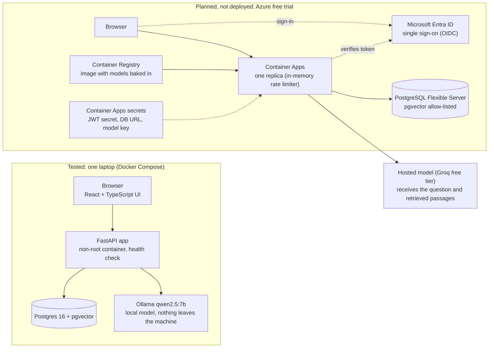
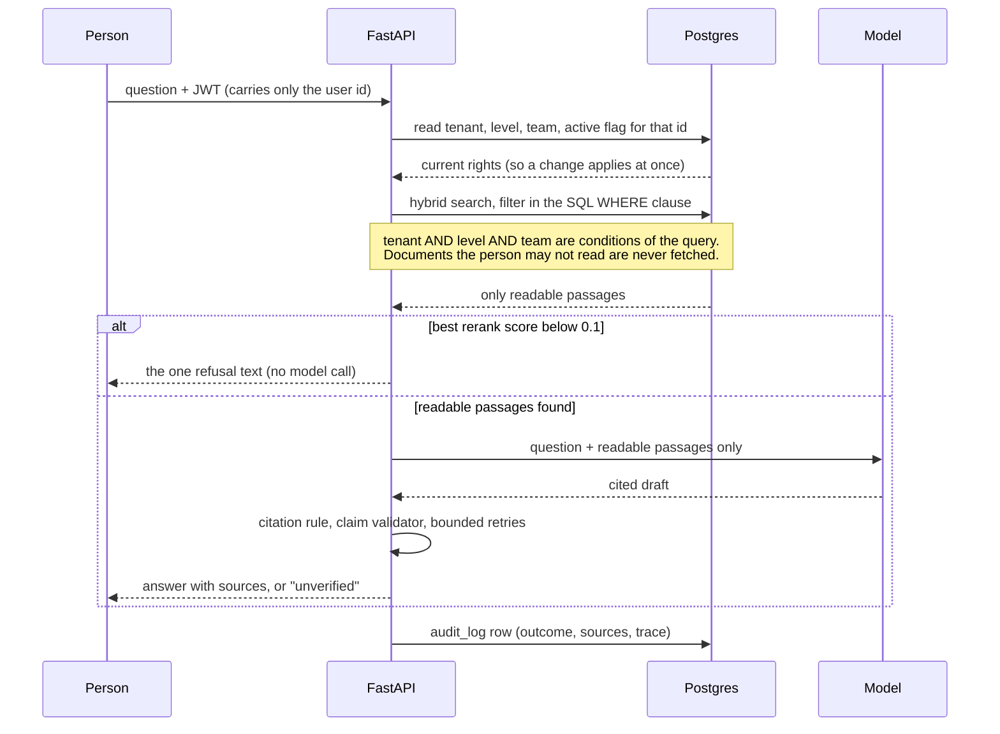

# Architecture

Three views: where the pieces run, how one request is kept inside the person's access, and how the answer pipeline is
built. The step-by-step pipeline diagram is in the [README](../README.md#architecture); this file does not repeat it.

## 1. Where it runs

**Tested today:** the left side (everything on one laptop, in Docker). **Not yet run:** the Azure side. It is the plan in
[DEPLOY_AZURE.md](DEPLOY_AZURE.md), and no part of it has been deployed.

The model is one setting (`LLM_PROVIDER`). Only `app/services/llm.py` knows about providers, so the prompts, the checks and
the access rules are the same on a laptop and in the cloud. The difference that matters for data: with a hosted provider the
question and the passages sent with it leave your environment ([THREAT_MODEL.md](THREAT_MODEL.md)).

## 2. How access is kept on every request

Three consequences worth being able to explain:

- **The token proves who, not what.** Rights are read from the database on each request, so lowering a level or switching off
  an account takes effect on the same token. The security matrix checks this live (M1, M3, M4).
- **The model never receives what the person may not read**, so it cannot leak it, whatever the prompt says.
- **Saved material is re-checked when it is read.** An old conversation or research report built on a document the person can no
  longer open shows a notice instead of the answer (M1d, M5, M5r).

## 3. How the code is organised

| Layer | Where | Role |
|---|---|---|
| Routes | `app/routers/` | login, chat, search, documents, admin, audit, SSO, research |
| Orchestrator | `app/agents/orchestrator.py` | plain code: decides the steps, retry limits and the audit record. Not a model. |
| Agents | `app/agents/` | corrector, rewriter, answerer, validator, fit checker, router, inspector. Each makes one bounded model call. |
| Services | `app/services/` | retrieval, reranking, chunking, ingest queue, access rules, rate limit, lockout, provider client |
| Data | Postgres + pgvector | documents, chunks, users, teams, audit log, job queue (a table, `FOR UPDATE SKIP LOCKED`) |

Permissions, retry limits and the audit record are never delegated to a model. Agents choose only inside fixed tools and
limits.

## What is not in this picture

No cache, no message broker (the job queue is a table), no multi-replica setup (the question rate limiter lives in
one process and would move to Redis behind several instances; the sign-in lockout is stored in the database and is not affected), and no monitoring beyond logs and optional tracing
([OPERATIONS.md](OPERATIONS.md)).
